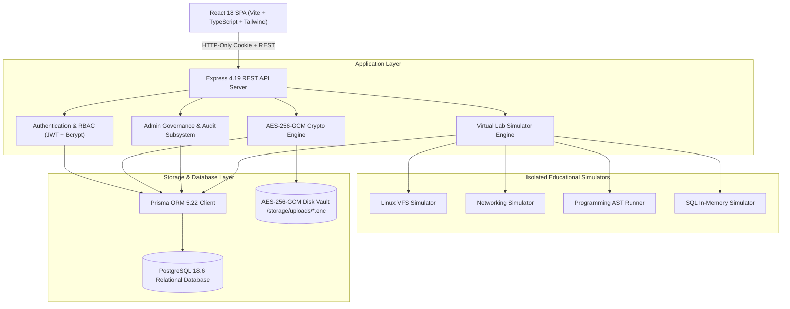

# Cloud Virtual Lab and Secure Storage Management System

[](https://www.typescriptlang.org/)
[](https://react.dev/)
[](https://nodejs.org/)
[](https://www.postgresql.org/)
[](https://www.prisma.io/)
[](https://vitest.dev/)
[](docs/SECURITY.md)
[](LICENSE)

An enterprise-grade, modular educational computing platform providing sandboxed **Virtual Laboratories** (Linux, Networking, Programming, SQL) and an **AES-256-GCM Encrypted Cloud Storage Vault** for university computer science and engineering curricula.

Designed with a React 18 TypeScript frontend, Express REST backend, and PostgreSQL persistence layer with full Role-Based Access Control (RBAC) and immutable administrative audit logging.

---

## 📌 Problem Statement

Traditional university computer science laboratories face critical logistical and cybersecurity challenges:

1. **Hardware & Configuration Drift:** Diverse student operating systems, incompatible library versions, and hardware maintenance costs create friction during practical coursework.
2. **Host Security Risks:** Giving students unfettered command-line or database administrative access on physical lab machines exposes the institution to fork bombs, accidental file deletions, privilege escalation, and malicious scripts.
3. **Insecure Academic Data Storage:** Students frequently store coursework, sensitive lab submissions, and exam assignments across unencrypted public cloud drives or unauthenticated local shared folders.
4. **Lack of Transparent Academic Governance:** University administrators and lab instructors lack real-time visibility into student progress, quota consumption, and audit trails of system access.

### The Solution: CloudLab OS
A centralized, browser-accessible environment that provides:
- **Zero-Host Execution:** 100% sandboxed software simulation of operating system shells and database catalogs.
- **Defense-in-Depth Cryptography:** Zero plaintext file storage on server disks using AES-256-GCM authenticated encryption with per-file cryptographic IVs and tags.
- **Granular Institutional RBAC:** Strict tenant isolation between students and comprehensive administrative oversight with immutable audit trails.

---

## 🌟 Main Features

### 1. Simulated Virtual Laboratories
- **Linux Terminal Simulator:** Interactive sandboxed shell supporting `pwd`, `ls [-la]`, `cd`, `mkdir`, `touch`, `cat`, `echo`, `whoami`, `uname`, and `clear` with an in-memory virtual filesystem (VFS).
- **Networking Diagnostic Console:** Realistic educational simulation of network diagnostics: `ping`, `ifconfig`, `nslookup`, `traceroute`, `netstat`, `curl`.
- **Programming Lab:** Safe AST and pattern evaluation for Python (`python3`) and JavaScript (`node`) exercises without host execution.
- **SQL Database Playground:** Isolated in-memory PostgreSQL relation catalog supporting `SELECT`, `INSERT`, `UPDATE`, `DELETE`, and meta-commands (`\dt`, `\d`, `\l`).
- **Zero Host Execution Guarantee:** Under no circumstances does user terminal input interact with the host operating system shell. Neither `child_process`, `exec`, `spawn`, nor `eval` is ever invoked.

### 2. Secure Cloud Storage Vault (AES-256-GCM)
- **Zero Plaintext on Disk:** Every uploaded file is encrypted in memory using **AES-256-GCM** before touching physical disk storage.
- **Unique IVs & Auth Tags:** Every file generates a unique 96-bit cryptographic Initialization Vector (IV), a 128-bit authentication tag for tamper resistance, and a SHA-256 integrity checksum.
- **Atomic Storage Quotas:** Per-user quota limits (default: 100 MB) enforced via atomic PostgreSQL row-level locks (`SELECT FOR UPDATE`) to prevent race conditions.
- **File Management:** Hierarchical folder organization, safe rename, move, in-browser previews, and permanent deletion with instant disk unlinking.
- **Anti-Malware & Path Traversal Guard:** Strict denylist blocks executable programs and scripts (`.exe`, `.bat`, `.sh`, `.ps1`, `.msi`, `.dll`, `.iso`). Filenames are normalized across cross-platform path separators.

### 3. Authentication & Multi-Tenant Isolation
- **HTTP-Only Cookie Sessions:** Strict SameSite JWT sessions immune to client-side XSS token theft.
- **Bcrypt Password Security:** Passwords salted and hashed with **12 rounds**; strict Zod complexity validation.
- **Brute-Force Rate Limiting:** Sensitive endpoints protected by `express-rate-limit`.
- **Multi-Tenant Isolation:** Complete data separation between students with strict 403 Forbidden enforcement.

### 4. Administrator Console & System Governance
- **Real-Time Telemetry:** Live dashboard metrics for total users, active labs, sessions started, and global cloud vault capacity.
- **User Directory & RBAC:** Search, filter, view detailed user telemetry, modify activation states (`ACTIVE`, `INACTIVE`, `SUSPENDED`), and manage student/admin roles.
- **Self-Protection & Root Admin Protection:** Built-in safeguards prevent admins from locking themselves out or modifying the primary root administrator.
- **Curriculum & Exercise Management:** Deploy new laboratory suites, toggle active states, configure exercises with validation criteria, and track student completion scores.
- **Immutable Audit Trail:** Append-only audit logging recording administrator ID, action, target entity, timestamp, IP, and state differentials (before vs after JSON).

---

## 🏛️ System Architecture



---

## 💻 Tech Stack

| Tier | Technologies | Purpose |
|---|---|---|
| **Frontend** | React 18, TypeScript, Vite, Tailwind CSS, Lucide React, Axios | Reactive Single Page Application |
| **Backend API** | Node.js 20+, Express 4.19, TypeScript, Zod, Multer, Helmet, CORS | RESTful API & Sandboxed Simulators |
| **Database & ORM** | PostgreSQL 18.6, Prisma ORM 5.22 | Relational Persistence & Type-Safe Queries |
| **Security & Crypto** | Node.js Built-in `crypto` (AES-256-GCM), Bcrypt.js (12 rounds), JWT | Authenticated at-rest encryption & auth |
| **Testing** | Vitest 1.6, Supertest | Unit, Integration & Security Test Suites |
| **Containers & Gateway**| Docker, Docker Compose, Nginx Alpine | Containerized Deployment & Reverse Proxy |

---

## 📸 Interface Showcase

### 1. Student Virtual Laboratory Workspace
```
+-----------------------------------------------------------------------------------+
| CloudLab OS  [Linux Command-Line Essentials]                        Score: 25 pts  |
+---------------------------------------------------+-------------------------------+
| student@cloudlab:~$ pwd                           |  [x] 1. Working Directory     |
| /home/student                                     |  [x] 2. Directory Creation    |
| student@cloudlab:~$ ls -la                        |  [ ] 3. File Content Viewing  |
| drwxr-xr-x 2 student student 4096 Nov 13 welcome  |-------------------------------|
| -rw-r--r-- 1 student student  142 Nov 13 notes    | Hint: Run "cat notes.txt"     |
| student@cloudlab:~$ _                             | [Submit] [Complete Session]   |
+---------------------------------------------------+-------------------------------+
```

### 2. Secure Cloud Storage Vault (AES-256-GCM)
```
+-----------------------------------------------------------------------------------+
| Storage Vault Quota: [████████░░░░░░░░░░░░░░░░░░░░] 24.5 MB / 100 MB (24%)        |
| [+ Upload File]  [+ New Folder]                      [Search Files...]            |
+-----------------------------------------------------------------------------------+
| Name                  Category     Size       Encryption        Uploaded          |
|-----------------------------------------------------------------------------------|
| research_report.pdf   DOCUMENT     2.4 MB     AES-256-GCM [OK]  Today, 14:20      |
| algorithm_code.py     CODE         14.2 KB    AES-256-GCM [OK]  Yesterday, 09:15  |
| architecture.png      IMAGE        1.1 MB     AES-256-GCM [OK]  Nov 11, 16:45     |
+-----------------------------------------------------------------------------------+
```

### 3. Administrator Governance Console
```
+-----------------------------------------------------------------------------------+
| ADMIN GOVERNANCE CONSOLE                                    Root Admin (Online)   |
+-------------------+-------------------+-------------------+-----------------------+
| Total Users: 14   | Active Labs: 4    | Lab Sessions: 38  | Vault Used: 24.5 MB   |
| (12 Std / 2 Adm)  | (All Online)      | (32 Completed)    | (AES-256-GCM Active)  |
+-------------------+-------------------+-------------------+-----------------------+
| [User Management] | [Lab Governance]  | [Storage Monitor] | [Audit Trail Feed]    |
+-----------------------------------------------------------------------------------+
```

---

## 🚀 Installation & Local Setup

### 1. Prerequisites
- **Node.js:** v20.x or v22.x LTS
- **PostgreSQL:** v16.x or v18.x (or Docker installed)
- **Git**

### 2. Clone the Repository
```bash
git clone https://github.com/your-org/cloud-virtual-lab.git
cd "cloud-virtual-lab"
```

### 3. Start PostgreSQL via Docker (Recommended)
```bash
docker compose up -d
```
*(Or connect to an existing local PostgreSQL 16/18 server on port 5432).*

### 4. Configure Environment Variables
Copy and customize the environment templates:
```bash
# In backend directory:
cd backend
cp .env.example .env

# In frontend directory:
cd ../frontend
cp .env.example .env
```

Generate secure 64-hex-character random keys for production:
```bash
node -e "console.log(require('crypto').randomBytes(32).toString('hex'))"
```

### 5. Install Dependencies, Migrate & Seed Database
```bash
# In backend directory:
cd ../backend
npm install
npm run prisma:generate
npx prisma migrate deploy
npm run prisma:seed
```

### 6. Install Frontend Dependencies
```bash
cd ../frontend
npm install
```

### 7. Run Development Servers

**Terminal 1 (Backend API - Port 5000):**
```bash
cd backend
npm run dev
```

**Terminal 2 (Frontend SPA - Port 5173):**
```bash
cd frontend
npm run dev
```

Open **`http://localhost:5173`** in your browser.

---

## 🔑 Default Credentials (Development Seed)

| Role | Email | Password | Access Level |
|---|---|---|---|
| **Primary Administrator** | `admin@virtuallab.edu` | `AdminSecurePassword123!` | Full Root Governance Privileges |
| **Student** | Self-register via `/register` | User defined | Student Lab & Vault Access |

---

## 🐳 Docker Production Deployment

To run the complete production stack (PostgreSQL, Backend API, and Nginx Frontend) with persistent encrypted storage volume mounting:

```bash
docker compose -f docker-compose.prod.yml up -d --build
```

- **Frontend Application:** `http://localhost:80`
- **Backend API:** `http://localhost:80/api/` (Reverse-proxied via Nginx)
- **Persistent Data Volumes:**
  - `postgres_data`: Relational database storage.
  - `encrypted_storage`: AES-256-GCM ciphertext volume (`/app/storage/uploads`).

---

## 🧪 Testing & Quality Assurance

The project includes **127 automated regression, integration, and security tests** across 6 suites:

```bash
cd backend
npm test
```

### Test Suite Execution Summary
```
 ✓ src/tests/security.test.ts  (43 tests) - Authentication, Multi-tenant, Storage Tampering & Isolation
 ✓ src/tests/lab.test.ts       (24 tests) - Linux, Networking, Programming & SQL Execution Engines
 ✓ src/tests/storage.test.ts   (27 tests) - AES-256-GCM Encrypted Uploads, Quota & Integrity Checks
 ✓ src/tests/admin.test.ts     (15 tests) - RBAC Enforcement, User Statuses & Audit Logging
 ✓ src/tests/auth.test.ts      (17 tests) - Bcrypt Hashing, JWT Cookies, Password Lifecycles
 ✓ src/tests/health.test.ts    (1 test)   - Infrastructure Health & Heartbeat

 Test Files  6 passed (6)
      Tests  127 passed (127)
   Duration  24.13s
```

### Production Build Validation
- **Backend Build:** `npm --prefix backend run build` (`tsc` $\rightarrow$ `backend/dist/server.js`)
- **Frontend Build:** `npm --prefix frontend run build` (`tsc && vite build` $\rightarrow$ `frontend/dist/`)

---

## 📚 Technical Documentation Directory

Deep technical specifications and architectural guides are available in the [`docs/`](docs/) directory:

- [System Architecture & Technical Design](docs/SYSTEM_ARCHITECTURE.md)
- [Database Schema & ER Specifications](docs/DATABASE_DESIGN.md)
- [REST API Reference & Integration Guide](docs/API_DOCUMENTATION.md)
- [Security Architecture & Threat Mitigation Guide](docs/SECURITY.md)
- [Installation, Setup & Verification Guide](docs/INSTALLATION_GUIDE.md)
- [End-User & Administrator Manual](docs/USER_GUIDE.md)
- [Secure Storage & Cryptography Specification](docs/SECURE_STORAGE_ARCHITECTURE.md)

---

## 🔮 Future Enhancements & Roadmap

- [ ] **Distributed Rate Limiting:** Replace in-memory rate limiting with Redis-backed distributed token buckets for multi-instance deployments.
- [ ] **KMS / HSM Envelope Encryption:** Add support for AWS KMS or HashiCorp Vault for automated master key rotation.
- [ ] **Collaborative Lab Sessions:** Implement WebSockets for live instructor observation and pair-programming lab sessions.
- [ ] **WebAssembly (Wasm) Engine:** Optional client-side WebAssembly Linux kernel simulator (e.g. v86 or WebAssembly Python).
- [ ] **LTI 1.3 LMS Integration:** Direct Single Sign-On and grade passback integration with Canvas, Moodle, and Blackboard.
- [ ] **Automated GitHub Classroom Sync:** Synchronize laboratory exercise repositories directly with student GitHub accounts.

---

## 🛡️ License & Academic Credits

Developed as a Capstone Computer Science & Engineering Software Engineering Project.  
Licensed under the **ISC License**.
