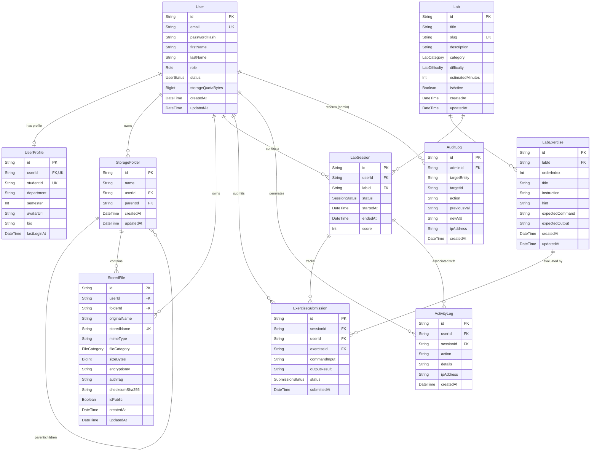

# Database Architecture & Schema Specification

## 1. Database Overview

The persistence tier of the **Cloud Virtual Lab and Secure Storage Management System** is built on **PostgreSQL 18.6** and managed via **Prisma ORM 5.22**.

### Key Design Principles
- **Relational Integrity:** Strict foreign key constraints with explicit referential actions (`onDelete: Cascade` or `onDelete: SetNull`).
- **Cryptographic Independence:** Cryptographic initialization vectors (`IV`), authentication tags (`authTag`), and checksums are stored as dedicated hexadecimal strings alongside file metadata, completely independent of raw file blobs.
- **Large-Number Precision:** Storage quotas and file sizes in bytes use PostgreSQL `BIGINT` (64-bit integer) to prevent 32-bit integer overflow (supporting petabyte-scale accounting).
- **Audit Immutability:** Audit trail and activity tables (`AuditLog`, `ActivityLog`) are append-only.

---

## 2. Entity-Relationship (ER) Diagram



---

## 3. Enumerated Types (Enums)

| Enum | Allowed Values | Description |
|---|---|---|
| `Role` | `STUDENT`, `ADMIN` | Role-based access control tier. |
| `UserStatus` | `ACTIVE`, `INACTIVE`, `SUSPENDED` | Account lifecycle state. |
| `LabCategory` | `LINUX`, `NETWORKING`, `PROGRAMMING`, `DATABASE` | Laboratory simulation engine type. |
| `LabDifficulty` | `BEGINNER`, `INTERMEDIATE`, `ADVANCED` | Educational curriculum difficulty. |
| `SessionStatus` | `IN_PROGRESS`, `COMPLETED`, `ABANDONED` | Virtual lab session state. |
| `SubmissionStatus` | `PASSED`, `FAILED`, `PENDING` | Automated exercise evaluation outcome. |
| `FileCategory` | `DOCUMENT`, `IMAGE`, `CODE`, `ARCHIVE`, `PDF`, `OTHER` | Upload classification for filtering. |

---

## 4. Table Specifications

### 4.1 `User`
Primary entity storing identity, credentials, roles, and aggregate storage quota.

| Column | Type | Nullable | Default | Constraints / Index | Description |
|---|---|---|---|---|---|
| `id` | `VARCHAR(36)` | No | `uuid()` | `PRIMARY KEY` | Unique user identifier. |
| `email` | `VARCHAR` | No | — | `UNIQUE`, `INDEX` | Institutional email (lowercased). |
| `passwordHash` | `VARCHAR` | No | — | — | Bcrypt hash (12 salt rounds). |
| `firstName` | `VARCHAR(50)` | No | — | — | User first name. |
| `lastName` | `VARCHAR(50)` | No | — | — | User last name. |
| `role` | `Role` | No | `STUDENT` | `INDEX` | `STUDENT` or `ADMIN`. |
| `status` | `UserStatus` | No | `ACTIVE` | — | Account access state. |
| `storageQuotaBytes`| `BIGINT` | No | `104857600` | — | Storage allocation (default: 100 MB). |
| `createdAt` | `TIMESTAMPTZ` | No | `now()` | — | Registration timestamp. |
| `updatedAt` | `TIMESTAMPTZ` | No | Auto | — | Last modification timestamp. |

---

### 4.2 `UserProfile`
Auxiliary academic profile associated 1-to-1 with a `User`.

| Column | Type | Nullable | Default | Constraints / Index | Description |
|---|---|---|---|---|---|
| `id` | `VARCHAR(36)` | No | `uuid()` | `PRIMARY KEY` | Profile identifier. |
| `userId` | `VARCHAR(36)` | No | — | `UNIQUE`, `FK (User.id, CASCADE)` | Owning user. |
| `studentId` | `VARCHAR(30)` | Yes | `null` | `UNIQUE` | Roll / matriculation ID. |
| `department` | `VARCHAR(100)`| Yes | `null` | — | Academic department. |
| `semester` | `INT` | Yes | `null` | — | Current semester (1-12). |
| `avatarUrl` | `VARCHAR` | Yes | `null` | — | Profile image URL. |
| `bio` | `TEXT` | Yes | `null` | — | Biographical notes. |
| `lastLoginAt` | `TIMESTAMPTZ` | Yes | `null` | — | Last successful login. |

---

### 4.3 `Lab`
Virtual laboratory metadata and suite configuration.

| Column | Type | Nullable | Default | Constraints / Index | Description |
|---|---|---|---|---|---|
| `id` | `VARCHAR(36)` | No | `uuid()` | `PRIMARY KEY` | Lab identifier. |
| `title` | `VARCHAR(150)`| No | — | — | Descriptive title. |
| `slug` | `VARCHAR(100)`| No | — | `UNIQUE` | URL slug (e.g. `linux-command-basics`). |
| `description` | `TEXT` | No | — | — | Curriculum objectives. |
| `category` | `LabCategory` | No | — | `INDEX` | Simulation domain. |
| `difficulty` | `LabDifficulty`| No| `BEGINNER` | — | Curriculum difficulty level. |
| `estimatedMinutes`| `INT` | No | `30` | — | Estimated completion time. |
| `isActive` | `BOOLEAN` | No | `true` | — | Activation toggle switch. |
| `createdAt` | `TIMESTAMPTZ` | No | `now()` | — | Creation timestamp. |
| `updatedAt` | `TIMESTAMPTZ` | No | Auto | — | Update timestamp. |

---

### 4.4 `LabExercise`
Ordered task criteria associated with a virtual laboratory.

| Column | Type | Nullable | Default | Constraints / Index | Description |
|---|---|---|---|---|---|
| `id` | `VARCHAR(36)` | No | `uuid()` | `PRIMARY KEY` | Exercise identifier. |
| `labId` | `VARCHAR(36)` | No | — | `FK (Lab.id, CASCADE)` | Parent laboratory. |
| `orderIndex` | `INT` | No | — | `UNIQUE(labId, orderIndex)` | Task sequence index. |
| `title` | `VARCHAR(200)`| No | — | — | Task title. |
| `instruction` | `TEXT` | No | — | — | Student instructions. |
| `hint` | `TEXT` | Yes | `null` | — | Educational hint. |
| `expectedCommand`| `TEXT` | Yes | `null` | — | Expected command pattern. |
| `expectedOutput` | `TEXT` | Yes | `null` | — | Output substring validation criteria. |

---

### 4.5 `LabSession`
Interactive session initiated by a student.

| Column | Type | Nullable | Default | Constraints / Index | Description |
|---|---|---|---|---|---|
| `id` | `VARCHAR(36)` | No | `uuid()` | `PRIMARY KEY` | Session identifier. |
| `userId` | `VARCHAR(36)` | No | — | `FK (User.id, CASCADE)`, `INDEX` | Student conducting session. |
| `labId` | `VARCHAR(36)` | No | — | `FK (Lab.id, CASCADE)`, `INDEX` | Lab being performed. |
| `status` | `SessionStatus`| No | `IN_PROGRESS` | — | Current session state. |
| `startedAt` | `TIMESTAMPTZ` | No | `now()` | — | Session start time. |
| `endedAt` | `TIMESTAMPTZ` | Yes | `null` | — | Session completion time. |
| `score` | `INT` | No | `0` | — | Points accumulated. |

---

### 4.6 `ExerciseSubmission`
Submission attempt records evaluating student performance.

| Column | Type | Nullable | Default | Constraints / Index | Description |
|---|---|---|---|---|---|
| `id` | `VARCHAR(36)` | No | `uuid()` | `PRIMARY KEY` | Submission identifier. |
| `sessionId` | `VARCHAR(36)` | No | — | `FK (LabSession.id, CASCADE)`, `INDEX` | Associated session. |
| `userId` | `VARCHAR(36)` | No | — | `FK (User.id, CASCADE)` | Submitting student. |
| `exerciseId` | `VARCHAR(36)` | No | — | `FK (LabExercise.id, CASCADE)`, `INDEX`| Associated exercise. |
| `commandInput`| `TEXT` | No | — | — | Exact command executed. |
| `outputResult`| `TEXT` | No | — | — | Terminal output captured. |
| `status` | `SubmissionStatus` | No | `PENDING` | — | `PASSED` or `FAILED`. |
| `submittedAt`| `TIMESTAMPTZ` | No | `now()` | — | Submission timestamp. |

---

### 4.7 `StorageFolder`
Hierarchical folder structure for student cloud storage.

| Column | Type | Nullable | Default | Constraints / Index | Description |
|---|---|---|---|---|---|
| `id` | `VARCHAR(36)` | No | `uuid()` | `PRIMARY KEY` | Folder identifier. |
| `name` | `VARCHAR(100)`| No | — | — | Folder name. |
| `userId` | `VARCHAR(36)` | No | — | `FK (User.id, CASCADE)`, `INDEX` | Owning user. |
| `parentId` | `VARCHAR(36)` | Yes | `null` | `FK (StorageFolder.id, CASCADE)` | Parent folder in hierarchy. |
| `createdAt` | `TIMESTAMPTZ` | No | `now()` | — | Folder creation date. |
| `updatedAt` | `TIMESTAMPTZ` | No | Auto | — | Last folder update. |

*Constraint:* `@@unique([userId, parentId, name])` guarantees no duplicate folder names exist under the same parent directory for a user.

---

### 4.8 `StoredFile`
Metadata and cryptographic parameters for encrypted files stored on disk.

| Column | Type | Nullable | Default | Constraints / Index | Description |
|---|---|---|---|---|---|
| `id` | `VARCHAR(36)` | No | `uuid()` | `PRIMARY KEY` | File record identifier. |
| `userId` | `VARCHAR(36)` | No | — | `FK (User.id, CASCADE)`, `INDEX` | Owning user. |
| `folderId` | `VARCHAR(36)` | Yes | `null` | `FK (StorageFolder.id, SET NULL)`, `INDEX` | Containing folder. |
| `originalName` | `VARCHAR(255)`| No | — | — | Display filename. |
| `storedName` | `VARCHAR` | No | — | `UNIQUE` | Random on-disk filename (`UUID.enc`). |
| `mimeType` | `VARCHAR` | No | — | — | Verified MIME content type. |
| `fileCategory`| `FileCategory`| No | `OTHER` | — | Classified file category. |
| `sizeBytes` | `BIGINT` | No | — | — | File size in bytes. |
| `encryptionIv`| `VARCHAR(24)` | No | — | — | Hexadecimal 96-bit AES-GCM IV. |
| `authTag` | `VARCHAR(32)` | No | — | — | Hexadecimal 128-bit Auth Tag. |
| `checksumSha256`| `VARCHAR(64)`| No | — | — | Plaintext SHA-256 digest. |
| `isPublic` | `BOOLEAN` | No | `false` | — | Sharing flag. |
| `createdAt` | `TIMESTAMPTZ` | No | `now()` | — | Upload timestamp. |
| `updatedAt` | `TIMESTAMPTZ` | No | Auto | — | Last modification timestamp. |

---

### 4.9 `ActivityLog` & `AuditLog`
Audit and operational telemetry tables.

#### `ActivityLog`
- Records user-level interactions (`USER_LOGIN`, `FILE_UPLOAD`, `FILE_DELETE`, `LAB_SESSION_STARTED`).
- Indexed on `userId` and `action`.

#### `AuditLog`
- Immutable audit log for administrative mutations (`UPDATE_USER_STATUS`, `UPDATE_USER_ROLE`, `UPDATE_USER_QUOTA`, `LAB_CREATE`, etc.).
- Records `adminId` (`FK -> User.id`), `targetEntity`, `targetId`, `action`, `previousVal` (JSON), `newVal` (JSON), `ipAddress`, and `createdAt`.

---

## 5. Database Management & Migration Procedures

### Migration Execution
In production, database migrations must be applied using:
```bash
npx prisma migrate deploy
```
This applies pending SQL migrations in `prisma/migrations` in transactional order without prompting or altering data outside migrations.

### Database Backup (`pg_dump`)
To take a full, consistent snapshot of the PostgreSQL database:
```bash
pg_dump -U postgres -h localhost -p 5432 -F c -b -v -f "cloud_virtual_lab_backup_$(date +%Y%m%d_%H%M%S).dump" cloud_virtual_lab
```

### Database Restore (`pg_restore`)
To restore from an encrypted or compressed custom-format backup dump:
```bash
pg_restore -U postgres -h localhost -p 5432 -d cloud_virtual_lab -v --clean --if-exists "cloud_virtual_lab_backup_YYYYMMDD_HHMMSS.dump"
```
