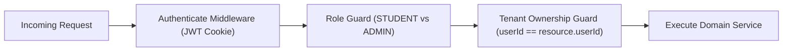

# Security Architecture, Cryptography & Threat Mitigation Guide

## 1. Security Overview & Threat Model

The **Cloud Virtual Lab and Secure Storage Management System** handles student laboratory activities and encrypted academic file storage. The security model assumes a zero-trust posture:

1. **Untrusted User Input:** All client-provided data (parameters, queries, file names, lab terminal commands) is treated as untrusted and potentially hostile.
2. **Untrusted Multi-Tenant Cohabitation:** Students must never access, view, modify, or download peer student files, directories, or laboratory sessions.
3. **Host Operating System Perimeter:** The host server operating system must remain completely inaccessible from simulated laboratory terminal commands.
4. **Data at-Rest Confidentiality:** Stored files on physical disk volumes must remain encrypted so that raw disk access or server snapshot leakage reveals zero plaintext data.

---

## 2. Cryptographic Architecture (AES-256-GCM)

```
[Plaintext In-Memory Buffer]
             │
             ├──> Generate Random 96-bit IV (crypto.randomBytes(12))
             ├──> Compute SHA-256 Digest of Plaintext (Integrity Checksum)
             ├──> AES-256-GCM Encrypt with 256-bit Key
             │
             ▼
  ┌──────────────────────────────────────────────┐
  │ 1. Encrypted Ciphertext -> storage/uploads/  │
  │ 2. 128-bit Auth Tag     -> PostgreSQL        │
  │ 3. 96-bit IV            -> PostgreSQL        │
  │ 4. SHA-256 Checksum     -> PostgreSQL        │
  └──────────────────────────────────────────────┘
```

### 2.1 Algorithm Specification
- **Cipher:** `aes-256-gcm` (Advanced Encryption Standard in Galois/Counter Mode).
- **Key Length:** 256 bits (32 bytes), derived from `STORAGE_ENCRYPTION_SECRET`.
- **Initialization Vector (IV):** Cryptographically secure, unique 96-bit (12-byte) pseudo-random byte sequence generated via `crypto.randomBytes(12)` per file.
- **Authentication Tag:** 128-bit (16-byte) tag verifying both ciphertext confidentiality and cryptographic authenticity.
- **Data Integrity Checksum:** SHA-256 cryptographic digest calculated prior to encryption and audited upon retrieval.

### 2.2 Tamper Detection & Resistance
If even a single bit of the encrypted file on disk is corrupted, or if an attacker modifies the stored authentication tag in the database, `decipher.final()` fails immediately during download and throws an integrity error (`HTTP 400 Bad Request`), refusing to stream corrupted bytes to the user.

### 2.3 Key Management & Secrets Isolation
- The master secret is held in memory and derived once at startup.
- The master secret is **never** transmitted in HTTP responses, written into database columns, or displayed in application logs.
- Plaintext files are held in memory during encryption and **never** written to temporary plaintext disk caches.

---

## 3. Authentication & Session Security

### 3.1 Password Storage & Salting
- **Algorithm:** Bcrypt with **12 salt rounds** (`$2a$12$` or `$2b$12$`).
- **Complexity Enforcement:** Zod regex validator requires:
  - Minimum 8 characters.
  - At least one uppercase letter (`A-Z`).
  - At least one lowercase letter (`a-z`).
  - At least one numeric digit (`0-9`).
  - At least one special symbol (`@$!%*?&#^()_+-=[]{};':"|,.<>/?`).

### 3.2 HTTP-Only Cookie Authentication
- Sessions use signed JSON Web Tokens (JWT) stored in HTTP cookies:
  - `httpOnly: true`: Completely prevents JavaScript execution context (XSS) from reading the authentication token.
  - `sameSite: 'strict'` (production) / `'lax'` (development): Prevents Cross-Site Request Forgery (CSRF).
  - `secure: true` (production): Enforces HTTPS transmission only.
  - `path: '/'`: Scope restricted to the application root.

### 3.3 Email Enumeration Defense
The login endpoint returns a generic `"Invalid email or password."` (`HTTP 401`) whether the account exists or the password was incorrect, preventing attackers from harvesting valid institutional email addresses.

### 3.4 Rate Limiting & Brute-Force Defense
- Public authentication routes (`/api/v1/auth/login`, `/api/v1/auth/register`) are guarded by `express-rate-limit`.
- Enforces a threshold of **20 attempts per 15-minute window** per IP address in production, returning `HTTP 429 Too Many Requests`.

---

## 4. Multi-Tenant Isolation & Authorization



1. **File & Folder Isolation:**
   - Every file and folder query explicitly filters by `where: { userId }`.
   - Modifying, renaming, downloading, moving, or deleting another student's file triggers `HTTP 403 Forbidden`.
2. **Lab Session Isolation:**
   - Lab sessions check `session.userId === req.user.id`.
   - Executing commands, submitting tasks, or ending another student's lab session triggers `HTTP 403 Forbidden`.
3. **Administrative Barrier:**
   - Student attempts to reach `/api/v1/admin/*` are rejected by `requireRoles(Role.ADMIN)` with `HTTP 403 Forbidden`.

---

## 5. Virtual Lab Command Sandboxing & Host Isolation

To ensure complete safety in an educational setting:

1. **Zero Host Execution:** The application **never** calls `child_process.exec()`, `execSync()`, `spawn()`, `eval()`, or VM subshells.
2. **Explicit Allowlisted AST Parsing:**
   - User command strings are tokenized and processed through static switch-case AST evaluations.
   - Arbitrary inputs (e.g. `; rm -rf /`, `&& whoami`, `| cat /etc/passwd`, `$(id)`, `` `dir` ``) are treated as safe literal strings and return simulated terminal feedback.
3. **SQL Playground In-Memory Isolation:**
   - Student SQL queries operate solely on in-memory mock datasets (`students`, `courses`).
   - Student SQL queries have zero access to the real PostgreSQL database connection. A query like `DROP TABLE "User"` has no effect on application data.
4. **Session State Bounds:**
   - Executing commands on a closed or completed lab session is blocked (`HTTP 400 Bad Request`).
   - Command length is capped at 2,000 characters by Zod validators to prevent memory exhaustion.

---

## 6. Administrative Governance & Audit Controls

### 6.1 Immutable Audit Logging
- Every administrative mutation (`UPDATE_USER_STATUS`, `UPDATE_USER_ROLE`, `UPDATE_USER_QUOTA`, `LAB_CREATE`, `ADMIN_DELETE_FILE`) writes to the append-only `AuditLog` table.
- Records `adminId`, `targetEntity`, `targetId`, `previousVal` (JSON), `newVal` (JSON), `ipAddress`, and `timestamp`.

### 6.2 Self-Protection Rule
An administrator is strictly prevented from deactivating, suspending, or demoting their own currently logged-in account, preventing accidental administrative lockouts.

### 6.3 Root Administrator Protection
The primary system administrator account (`admin@virtuallab.edu`) cannot be deactivated, suspended, or demoted by any secondary administrator (`HTTP 400 Bad Request`).

---

## 7. Secure File Upload Hardening

1. **Dangerous Extension Denylist:**
   - Prohibits executable programs, installation packages, and scripts:
     `.exe`, `.bat`, `.cmd`, `.sh`, `.msi`, `.vbs`, `.scr`, `.pif`, `.com`, `.jar`, `.app`, `.dmg`, `.reg`, `.ps1`, `.dll`, `.iso`, `.hta`, `.cpl`, `.wsf`.
2. **Cross-Platform Path Traversal Neutralization:**
   - Uploaded file names are normalized across both `/` and `\` separators:
     ```typescript
     originalName: path.basename(file.originalname.replace(/\\/g, '/'))
     ```
   - Rename and folder creation operations enforce regex `^[^/\\:*?"<>|]+$`, rejecting path traversal syntax.
3. **Disk Quota Enforcement:**
   - Quotas are validated inside an atomic PostgreSQL row-level lock (`SELECT FOR UPDATE`) before writing to disk, eliminating race conditions during parallel file uploads.
4. **Immediate Disk Cleanup on Deletion:**
   - Deleting a file immediately unlinks the ciphertext blob from the filesystem and removes the database record.
