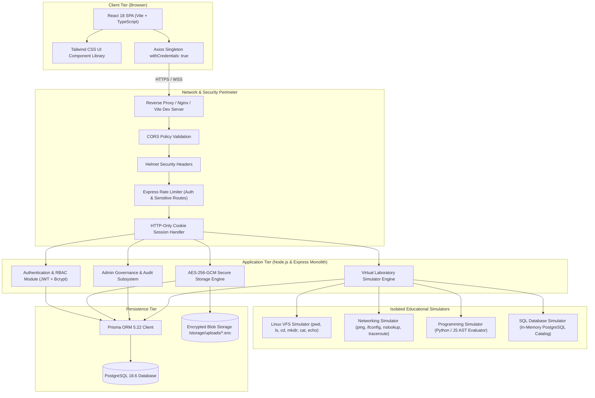
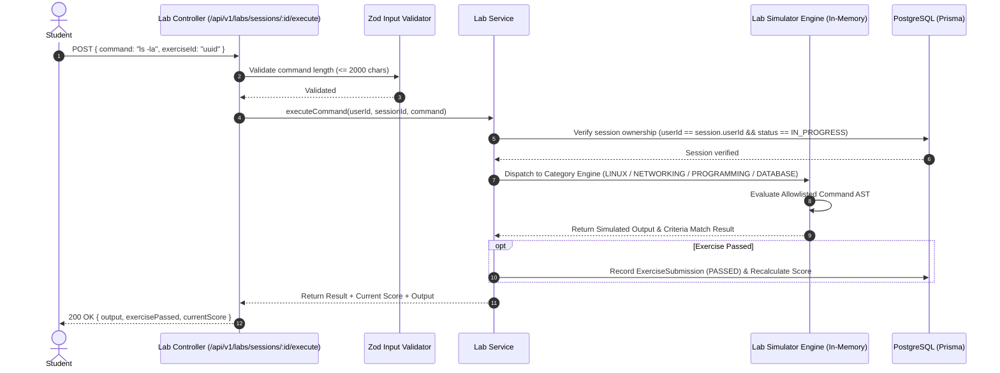
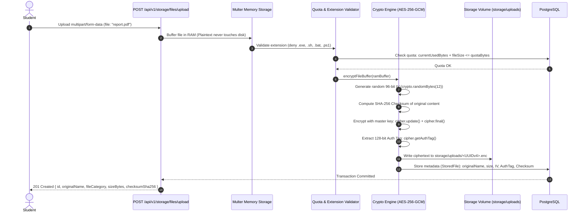

# System Architecture & Technical Design

## 1. Architectural Philosophy

The **Cloud Virtual Lab and Secure Storage Management System** is designed as a secure, modular educational platform that balances interactive practical learning with zero-trust security and end-to-end data confidentiality.

The system adheres to the following foundational architectural principles:

1. **Modular Monolith Architecture:** Backend domains (Authentication, Laboratory Execution, Encrypted Storage, and Administrative Governance) are structured as decoupled modules sharing a unified PostgreSQL relational persistence tier.
2. **Zero-Trust Host Isolation:** Under no circumstances does student input interact with the host operating system shell. Commands are parsed and evaluated inside sandboxed, educational software simulators.
3. **Defense-in-Depth Cryptography:** Files uploaded to the cloud storage vault are encrypted in memory using **AES-256-GCM** authenticated encryption before writing to disk, ensuring zero plaintext exposure at rest.
4. **Strict Multi-Tenant Separation:** All database records and file operations strictly enforce tenant boundaries through indexed foreign keys and authorization checks.
5. **Auditable Governance:** All privileged administrative mutations produce immutable audit log entries recording the administrator, target entity, timestamp, IP address, and state differential.

---

## 2. High-Level Architecture Diagram

---

## 3. Tiered System Breakdown

### 3.1 Presentation Tier (Frontend)
- **Framework:** React 18 with TypeScript and Vite build toolchain.
- **Styling:** Tailwind CSS with modern dark-mode aesthetic (slate/indigo/cyan palette).
- **Icons & Controls:** Lucide React icons, accessible modals, drawers, tabs, and toast notifications.
- **State Management & Contexts:**
  - `AuthContext`: Manages authenticated student/admin profile, session state, and login/logout lifecycles.
  - `ToastContext`: Global notification queue for operational feedback (success, error, warning).
- **Routing & RBAC:** React Router v6 with `<ProtectedRoute>` wrapping authenticated student and administrative routes. Unauthorized student attempts to access `/admin/*` are automatically redirected to the dashboard.
- **HTTP Client:** Centralized Axios singleton (`api.ts`) configured with `withCredentials: true` to seamlessly transmit HTTP-only cookies without exposing raw tokens to client JavaScript (XSS mitigation).

### 3.2 Application & Business Tier (Backend)
- **Runtime:** Node.js 20+ with Express and TypeScript.
- **API Architecture:** RESTful versioned endpoints mounted under `/api/v1/`.
- **Validation Pipeline:** Every incoming payload is validated using **Zod** schemas before reaching controller logic, eliminating malformed, oversized, or malicious input vectors.
- **Centralized Error Handling:** Standardized error handler maps custom `AppError`, Prisma exceptions (e.g. `P2002` uniqueness conflicts), Multer errors (`LIMIT_FILE_SIZE`), and JWT session failures into uniform JSON error envelopes.

### 3.3 Security & Cryptography Engine
- **Session Security:** JSON Web Tokens (JWT) signed with HMAC-SHA256 and stored in `HttpOnly`, `SameSite=Strict`, `Path=/` browser cookies.
- **Password Protection:** Passwords salted and hashed with **Bcrypt (12 rounds)**.
- **At-Rest Storage Encryption:** AES-256-GCM authenticated encryption engine using Node.js built-in `crypto` module.
- **Role-Based Access Control (RBAC):** Middleware-enforced permissions (`Role.STUDENT` vs `Role.ADMIN`).

### 3.4 Persistence Tier (PostgreSQL + Encrypted Disk)
- **Database Engine:** PostgreSQL 18.6 with schema managed by Prisma ORM 5.22.
- **Relational Integrity:** Foreign key constraints, cascading deletions for dependent session/submission records, and uniqueness constraints on emails and file slugs.
- **Encrypted Storage Directory:** Pure ciphertext storage (`storage/uploads/*.enc`). Raw plaintext is processed strictly in memory and is never written to disk unencrypted.

---

## 4. Virtual Lab Execution & Sandboxing Architecture

### The Educational Sandbox Model
Unlike hosting a dangerous multi-tenant shell container or invoking `child_process.exec()`, this platform implements an **application-level simulated virtual environment**:

### Simulator Engines
1. **Linux Virtual Filesystem (VFS):**
   - Implements an in-memory tree of `VirtualNode` structures starting at `/home/student`.
   - Supports: `pwd`, `ls`, `cd`, `mkdir`, `touch`, `cat`, `echo`, `whoami`, `uname`, `clear`, `help`.
   - Directory traversal (`..`, `/`) is bounded strictly within the simulated root.
2. **Networking Console:**
   - Predefined realistic diagnostic responses for `ping`, `ifconfig`, `nslookup`, `traceroute`, `netstat`, `curl`.
   - Teaches IP addressing, DNS resolution, and latency concepts without generating real outbound socket traffic.
3. **Programming Runner:**
   - Evaluates Python (`python3 script.py`) and JavaScript (`node app.js`) test fixtures and code expressions using pattern parsing without executing code on the host operating system.
4. **SQL Database Playground:**
   - Completely isolated in-memory relational simulation holding sample tables (`students`, `courses`).
   - Supports `SELECT`, `INSERT`, `UPDATE`, `DELETE`, and PostgreSQL meta-commands (`\dt`, `\d`, `\l`).
   - Disconnected from the real application database: student SQL queries cannot access `"User"`, `"StoredFile"`, or any system table.

---

## 5. End-to-End Cryptographic Flow (AES-256-GCM)

---

## 6. Audit Logging & Governance Architecture

Every state-changing administrative action produces two distinct layers of telemetry:

1. **System Activity Logs (`ActivityLog`):**
   - High-level telemetry recording actions taken by all users (`USER_LOGIN`, `FILE_UPLOAD`, `FILE_DELETE`, `LAB_SESSION_STARTED`, etc.).
   - Records `userId`, `action`, `details` (JSON string), and `ipAddress`.
2. **Administrative Audit Trail (`AuditLog`):**
   - High-security immutable audit trail for administrative mutations.
   - Records `adminId`, `targetEntity` (`USER`, `LABORATORY`, `STORED_FILE`), `targetId`, `action`, `previousVal` (JSON), `newVal` (JSON), and `ipAddress`.
   - Enables auditing state differentials (before vs after) to prevent administrative abuse.
